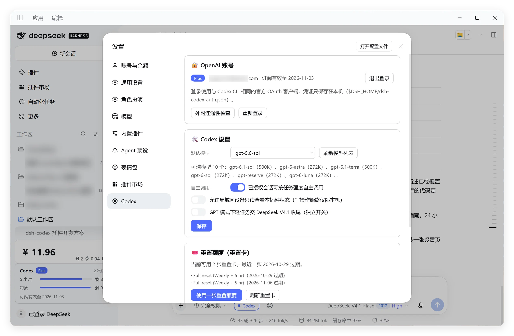

# dsh-codex-gpt

把 **ChatGPT / OpenAI Codex** 接入 [DeepSeek Harness (DSH)](https://github.com/deepseek-ai) 的插件：既能在模型选择器里把 **ChatGPT 当作一个 LLM provider 直接对话**，也能让 DeepSeek 在会话内按需把难任务**转交给 GPT 做独立分析或代码构建**。

全程使用 **ChatGPT 订阅额度**，走 OpenAI 官方 OAuth 登录，不需要填写 API Key，不产生 OpenAI API 计费。



---

## 特性

### 1. ChatGPT 作为 LLM provider（直接对话）

- 模型选择器新增 **「ChatGPT」** provider（内部 id **`openai-codex`**，与生态对齐：`@dougen/dsh-deepseek-usage` 等按这个 id 识别 ChatGPT 订阅的插件可以直接认出来），选中后整个对话由 GPT 处理：完整上下文、流式输出、工具调用。
- 旧版本注册过的 id `chatgpt-codex` 仍**同时注册**（分组名显示为「ChatGPT（旧 id）」），升级前保存过模型选择的老会话不会变成不可路由；把老会话的模型重选一次后就只走新 id 了。
- 模型列表**实时**从账号可用模型拉取（`gpt-6.1-sol`、`gpt-6-astra`、`gpt-5.6-sol` …），不写死。
- 支持**思考强度**：`Off / Low / High / Max`，默认 `High`，内部映射到 Codex 的 `reasoning.effort`（`Max → xhigh`，`Off → 不发送 reasoning`）。
- 支持**图片输入**：贴图直接发给 GPT（经 `ctx.attachments.readImage` 读取并编码为 `input_image`）。
- 模型列表带 5 分钟缓存，并对 HTTP 429 限流自动回退，不会污染界面。
- 模型目录**落盘缓存**（`$DSH_HOME/dsh-codex-models.json`）：插件刚启动、上游还没返回时也先给上次的完整目录，并把已配置模型始终并进列表——不会出现「模型先消失、要手动重选」。刷新只在后台进行。
- 登录/刷新拿到的 OAuth 令牌会**自动同步**（节流 60 秒，且绝不在模型列表这种高频路径上写，避免触发 DSH 的凭证变更事件导致界面反复刷新）到 `DSH_USAGE_CODEX_OAUTH_TOKEN` / `DSH_USAGE_CODEX_ACCOUNT_ID` 两个凭证引用，`@dougen/dsh-deepseek-usage` 这类用量插件不必再手填令牌（同步失败只影响那张卡，不影响对话）。
- **GPT 模式轻任务委派（独立开关）**：开启后，ChatGPT 处理会话时会把格式化、整理、检索归纳、润色等轻任务交给 **DeepSeek V4.1** 完成并收尾，复杂任务仍由 GPT 直接处理；随时可关。

### 2. `codex` 工具（DeepSeek 自主升级）

- **会话级授权**：输入框左侧的胶囊按钮控制当前会话（显示名随当前模型变化：本插件 ChatGPT 时显示「DeepSeek」，其余显示「ChatGPT」）；未授权会话绝不会调用 OpenAI。
- 已授权会话中，DeepSeek 按任务强度决定是否调用 `codex` 工具；可在设置里关闭「自主调用」。
- 两种模式：`analyze`（架构分析、疑难 bug 定位、方案评审、安全审计）与 `build`（直接产出可落地代码/补丁）。

### 3. 用量看板（兼容 ChatGPT 的自适应看板）

- 侧边栏底部一张卡片，**默认「自动」**：跟着当前在用的模型走——用 ChatGPT 就显示 ChatGPT，用 DeepSeek 就显示 DeepSeek；也可以在设置里固定成某一家（`用量卡默认显示`）。
- **点卡片空白处**：在 ChatGPT → DeepSeek → 其它已配置的 AI 之间循环切换。
- **点当前那家的名字**：立刻重新读取（刷新）这一家的数据。
- ChatGPT 页：5 小时限额 / 每周限额 / 订阅状态 / 到期时间 / 可用重置卡（设置页可消费，二次确认、不可逆）。
- DeepSeek 页（本插件自带，不依赖别的插件）：
  - **实时余额**（人民币，10 秒缓存），标题旁标「按量计费」；
  - **高峰期 / 空闲期**指示：北京时间 **00:30–08:30 为空闲（折扣价）**，其余为标准价，并显示距离下一次切换的倒计时；
  - 余额读不到时明确显示原因（如未配置 `DEEPSEEK_API_KEY`），不会编造数字；
  - 更新节奏：余额每 **10 秒**自动刷新；点当前那家的名字会**立即强制重查**；切模型 **3 秒**内自动跟随；
  - 余额端点跟随 `DEEPSEEK_BASE_URL`（与 DeepSeek 适配器同口径），没设就用官方 `api.deepseek.com/user/balance`。
- 如果机器上还装了别的用量插件（如 `@dougen/dsh-deepseek-usage`），它已经配好的其它 AI（Kimi / GLM / OpenRouter / MiniMax …）会自动出现在切换列表里；不装也完全可以只用本插件。

### 4. 诊断

- 设置页一键检查 `api.openai.com`、`chatgpt.com`、`auth.openai.com` 三条链路。
- `/dsh-codex-api` 状态路由暴露登录态、provider 注册状态与模型目录诊断信息。

---

## 安装

DSH 中通过 **插件管理** 以本地 bundle 方式安装：

1. 打开「插件 → 插件管理」；
2. `install_bundle`，target 指向本目录（或发布后的包名 `dsh-codex-gpt`）；
3. 安装后 bundle 条目 id 为 `dsh-codex-gpt`。

> 本包以 `link:` 方式安装到 profile 时，Node 从包的真实目录解析依赖，因此
> `node_modules/`（含 `@deepseek-ai/schemastery` 等）需要随包本地存在，但**不提交到 git**。

---

## 登录

1. 打开 **设置 → ChatGPT** → 点「登录 OpenAI 账号」；
2. 浏览器跳转 `auth.openai.com` 官方授权页，登录并同意；
3. 回调本机 `http://localhost:1455/auth/callback` 完成授权（端口占用会明确提示）。

凭证仅保存在本机 `$DSH_HOME/dsh-codex-auth.json`，与 Codex CLI 的 `auth.json` 相互独立。

---

## 使用

### 方式 A：直接和 ChatGPT 对话

1. 完成登录；
2. 点输入框的模型选择器，选 **ChatGPT** 分组下的任意模型；
3. 可在同一菜单里调整**推理等级**（Off / Low / High / Max）；
4. 正常对话即可，支持贴图。

### 方式 B：让 DeepSeek 自主调用 Codex

1. 模型保持在 DeepSeek（V4.1）；
2. 点输入框左侧胶囊按钮授权当前会话；
3. 遇到高难度任务时 DeepSeek 会调用 `codex` 工具，并在回答中说明所用模型与耗时。

---

## 配置

以下字段可在 profile 的 `cordis.patch.yml` 中修改：

| 字段 | 默认 | 说明 |
| --- | --- | --- |
| `defaultModel` | `gpt-5-codex` | 默认模型（候选从 OpenAI 实时拉取） |
| `autoConsult` | `true` | 允许模型自主按任务强度调用 `codex` 工具 |
| `allowLanAccess` | `false` | 允许局域网设备**只读**查看插件状态（写操作始终仅限本机） |
| `delegateLightTasks` | `false` | GPT 模式下允许把轻任务交给 DeepSeek V4.1 收尾（独立开关，可随时关闭） |
| `gptNameDetect` | `false` | 保险开关：开启后其他 provider 的模型名形如 `gpt-*` / `o3-*` 也按 GPT 识别（影响胶囊显示名） |
| `deepseekModel` | 空 | 轻任务委派使用的 DeepSeek 模型 id；留空自动选择当前可用模型 |

持久化数据：

| 路径 | 内容 |
| --- | --- |
| `$DSH_HOME/dsh-codex-auth.json` | OAuth 凭证（access/refresh token、账号信息） |
| `$DSH_HOME/dsh-codex.json` | 按会话的授权状态与模型选择 |

---

## 架构

| 文件 | 作用 |
| --- | --- |
| `index.js` | Host 插件入口：`codex` 工具、会话授权、系统提示策略段、LLM 适配器注册、设置页 provider 目录、`/dsh-codex-api` 路由 |
| `llm-adapter.js` | DSH `LlmAdapter` 适配器：模型目录、思考强度、图片输入、SSE → `StreamChunk` 转换 |
| `codex.js` | Codex 后端调用层：`codex/responses`（SSE）、`codex/models`、重置卡查询/消费 |
| `oauth.js` | OpenAI OAuth：PKCE、1455 回调服务器、token 交换/续期、凭证存储 |
| `usage.js` | ChatGPT 订阅用量（`wham/usage`），插件凭证优先、兼容 Codex CLI |
| `network.js` | 外网连通性检查 |
| `client.js` | 浏览器侧：输入框授权胶囊、侧边栏用量卡片、设置页 |
| `cordis.patch.yml` | 插入主机行 `id: dsh-codex-gpt` |
| `test/` | `node --test` 单测（105 条，含安全回归、卡片真实渲染、客户端冒烟与 i18n 校验） |

数据流（方式 A）：

```
DSH Agent Loop
  └─ llm.prepareCall → openai-codex 适配器
       └─ POST chatgpt.com/backend-api/codex/responses (SSE)
            └─ StreamChunk: text / reasoning / tool-call / usage / finish
```

---

## 开发

```bash
npm install          # 或使用本地 vendored node_modules
node --test "test/codex.test.mjs" "test/usage.test.mjs" "test/host.test.mjs" "test/adapter.test.mjs"
```

测试全部使用 `node:test` + mock 网络，不需要真实 OpenAI 凭证。

---

## 安全边界

- 状态路由 `/dsh-codex-api` 默认**仅接受本机回环地址**，并校验 `Origin`、`Sec-Fetch-Site`、`Host` 与 `Content-Type: application/json`；
- 同源判断兼容 `127.0.0.1` / `localhost` / `[::1]` 等本机别名（协议与端口需一致），外部域名伪造 `Origin` 一律拒绝；
- 写操作（授权、登录、登出、兑换重置卡、改配置）**必须携带进程级随机令牌** `x-dsh-write-token`：令牌只随同源 GET 快照下发给本机页面，跨站页面读不到响应体因此拿不到，代理场景下也无法伪造写操作；
- 请求带 `Origin` 时必须与本站同源（兼容本机别名）；桌面外壳等不发 `Origin` 的同源场景由上面的随机令牌兜底；
- 请求若携带 `X-Forwarded-For` / `X-Real-IP` / `Forwarded` / `CF-Connecting-IP`，一律按**远程**处理，不再享受本机权限；
- `Host` 校验不依赖 `getOrigin()` 是否可用：即使端口来源信息缺失，非回环 Host 也会被拒绝（防 DNS rebinding）；
- `allowLanAccess: true` 时局域网设备**只能只读查询**；登录、登出、兑换重置卡等写操作必须在运行 DSH 的本机执行；
- OAuth 回调页回显的 URL 参数（如 `error`）全部做 HTML 转义，防止反射型 XSS；回调**先校验 `state`** 再处理错误参数；
- 凭证文件以 `0600` 权限写入（POSIX 系统），token **不会**通过状态路由回传给浏览器；
- 插件只读 Codex CLI 的 `auth.json`，**不替其他应用刷新或轮换**其 token；
- 局域网模式下的只读数据已脱敏（不返回邮箱、姓名、订阅起止、用量、模型目录、配置细节与重置卡）；
- 会话授权**不继承**给子代理（subagent）或 fork 出的新会话；
- 未登录 / 未授权时不会发起任何 OpenAI 请求；
- 状态路由只接受 `GET` / `POST`，其余方法一律 `405`（不能靠 `PUT/PATCH/DELETE` 绕过写令牌）；
- 侧边栏「跟随当前模型」轮询走轻量端点 `?meta=1`（只回当前 provider/model 与默认 tab，不含邮箱、套餐、用量、写令牌，也不触发凭证写入）；
- 用量卡与**整个设置页**跟随 DSH 界面语言（中/英）：语言来源依次是 `locale` 服务快照 → `<html lang>`（DSH 会把当前语言写在这里）→ 中文兜底，切换语言后卡片立即更新（2 秒内）；
- 卡片外面包了一层兜底组件，单个组件渲染出错只会显示一行提示，不会让整块卡片消失；
- 设置页顶部显示**当前插件版本号**（直接读 `package.json`，避免两处版本号写歪）；
- `credentials` 写入做了三件事：串行化（避免并发写触发多次模型目录刷新）、写前比较现值（值没变就不写）、登出时连同镜像 token 一起 `unset`；
- 模型目录落盘缓存带**账号指纹**（`accountId` 的 SHA-256 前缀），换账号/登出会丢弃上一账号的目录；
- DeepSeek 余额缓存键包含 **API Key 指纹 + base URL**，同一来源换了 Key 不会复用上一账号的余额；失败结果不会覆盖上次成功的金额。

### 威胁模型说明（诚实边界）

上面的防护针对的是**浏览器跨站请求**（CSRF / DNS rebinding / 恶意网页读响应）与**局域网其他设备**。它**不能**防御同一操作系统用户下的本机原生进程：那类进程可以直接读取 DSH 的凭证文件，也能自己发 HTTP 请求并拿到写令牌，因此本机的安全边界依赖操作系统的用户隔离，而不是插件的令牌。如果需要更强隔离，请让 DSH 以更低权限的独立用户运行。

---

## 已知限制

- 依赖 ChatGPT 后端的若干**非公开接口**（`codex/responses`、`codex/models`、`wham/usage`、`wham/rate-limit-reset-credits`），OpenAI 调整协议时可能需要适配；
- `codex` 工具与模型列表均受账号订阅额度约束，额度用尽需等待重置周期或使用重置卡；
- OAuth 回调固定占用本机 `1455` 端口（同时尝试监听 `127.0.0.1` 与 `::1`；系统禁用 IPv6 时自动只保留 IPv4）；
- **不建议在 DSH 前面挂反向代理**：虽然写操作有随机令牌保护、转发头也会降级为远程，但只读快照仍可能暴露给代理后的访问者，最稳妥的做法仍是仅本机暴露；
- 多个 DSH 实例共享同一个 `$DSH_HOME` 时，会话授权状态是整文件覆写，可能互相覆盖；
- 浏览器侧 UI 文案目前硬编码中文，未接入 `ctx.locale` 本地化。

---

## 免责声明

本项目为第三方社区插件，与 OpenAI 及 DeepSeek 官方无隶属关系。使用 ChatGPT 订阅额度调用后端接口可能受服务条款约束，请自行评估合规性与风险。

---

## License

MIT
